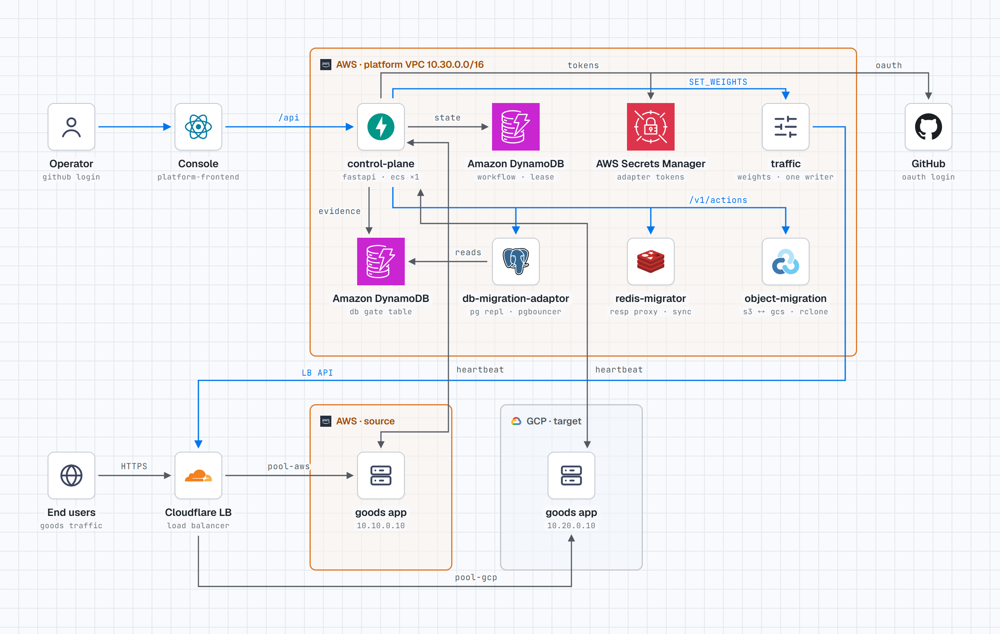

# control-plane



> 파란 선은 제어 명령, 회색 선은 상태·근거·트래픽입니다. 양방향 화살표는 앱의 heartbeat와 플랫폼의 업무 검사입니다. [인터랙티브 버전](https://claude.ai/artifact/QMfrqiTnyDfViBgicQxv9i)

Foxtrot 플랫폼 백엔드입니다. 세 이전 서버(DB, Redis, 오브젝트)와 트래픽 서비스를 정해진 순서로 제어하고, 콘솔에 진행 상황과 제어 수단을 제공합니다.

- 설계: [플랫폼 백엔드 설계 초안](https://app.notion.com/p/40f8bee9ada48174b929d433081f41b6)
- 공통 API: [마이그레이션 공통 Design Doc](https://app.notion.com/p/40d8bee9ada4815e9e94ee454be82d4a). `tests/contract/common-api.json`은 `db-migration-adaptor@1eac972`의 계약 사본입니다.
- 앱이 구현할 내용: [docs/app-integration.md](docs/app-integration.md)
- 온프렘 PC 등록과 앱 배포: [docs/onprem-platform-deployment.md](docs/onprem-platform-deployment.md)
- DB 에이전트 연결: [docs/native-db-agent.md](docs/native-db-agent.md). 기본은 PostgreSQL 직접 논리 복제입니다. DMS 작업과 Promote를 사용하지 않습니다.
- 콘솔의 Proxy·Worker 상태와 복제량: [모듈 관측값 전달](docs/module-observations.md).

## 구조

```txt
src/control_plane/
  domain/       저장하는 모델과 전환 순서
  store/        DynamoDB·메모리 테이블, 키 구조를 아는 유일한 곳인 Repository
  adapters/     client: 공통 API 호출 / profiles: 어댑터별 의미 차이
  engine/       commands: 명령 1회 효과 보장 / stages: 단계 핸들러
                recovery: 롤백·중단·대조 / engine: 틱 루프
  workload/     앱 업무 정지·재개와 실제 정지 확인
  dbgate.py     DB 이전 서버의 정지 근거 기록 (SDK를 아는 유일한 곳)
  traffic.py    트래픽 서비스 호출 (트래픽 서비스를 아는 유일한 곳)
  probes.py     실제 앱 경로 업무 검사와 카나리 관측
  workflows.py  사람이 내리는 명령과 허용 상태
  auth.py       GitHub 로그인과 세션
  api/          HTTP 표면
  main.py       조립과 실행
```

### 지켜야 할 규칙

1. **엔진은 상태를 메모리에 두지 않습니다.** 틱마다 읽고 한 가지를 수행한 뒤 저장합니다. 어느 두 틱 사이에 프로세스가 죽어도 이어서 진행합니다.
2. **외부 변경 전에 의도를 먼저 기록합니다.** 응답을 잃으면 저장한 키와 본문을 그대로 재전송해 원래 작업을 찾습니다.
3. **리소스별 차이는 `profiles.py`에만 둡니다.** 새 리소스는 프로필 하나를 추가합니다. 엔진에 `if redis:`를 넣지 않습니다.
4. **판정에 `phase` 문자열을 쓰지 않습니다.** 분기는 `lifecycle`, `health`, `readiness`, `checks`, `details`로 합니다.
5. **모르면 멈춥니다.** 결과가 불명이면 RECONCILE 전까지 다음 변경을 보내지 않습니다. 자동으로 실행하는 되돌리기는 데이터 경로를 바꾸지 않는 트래픽 가중치뿐입니다.
6. **시간은 `Clock`으로만 읽습니다.** 그래서 시간 관련 동작을 실제로 기다리지 않고 시험합니다.

## 로컬 실행

요구 사항은 [uv](https://docs.astral.sh/uv/)입니다. Python 3.13은 uv가 설치합니다.

```bash
make setup
```

```bash
cp config/seed.example.yaml config/seed.yaml
```

`config/seed.yaml`을 환경에 맞게 고치고 `.env.example`을 `.env`로 복사합니다. 로컬에서는 메모리 저장소와 로그인 생략을 쓸 수 있습니다. 이 두 설정은 `CONTROL_PLANE_ENVIRONMENT=local`에서만 허용합니다.

```bash
make run
```

`platform-frontend`의 개발 서버가 `/api`를 `127.0.0.1:8000`으로 전달하므로 그대로 연결됩니다. API 문서는 <http://127.0.0.1:8000/docs>에 있습니다.

### 앱별 고정 프록시 연결

마이그레이션 엔진은 시드에 등록한 **앱 하나**를 관리합니다. `GET /v1/applications`로 해당 앱을 조회하고 하위 deployment API로 배포합니다. 클라이언트가 앱을 추가 등록하는 API는 없습니다. 마이그레이션용 시드와 어댑터 등록은 별도로 맞춥니다. DB·Redis의 API와 실행기는 각 앱의 고정 프록시 실행기에 함께 있으며, 시드의 `adapters` 또는 `resources.database.adapter`·`resources.redis.adapter`에서 주소와 인증 참조를 선택합니다. 워커 풀과 임시 프록시 전환은 사용하지 않습니다.

앱 기동 전에 `POST /v1/applications/{application}/bindings`에 `{}`를 보내면 시드의 source로 DB·Redis 바인딩을 등록합니다. 직접 입력할 때는 `{"sources":{"DATABASE":{...},"REDIS":{...}}}`를 보냅니다. 바인딩이 준비될 때까지 `GET /v1/applications/{application}/bindings`로 확인합니다. DB 등록은 비동기이므로 첫 응답이 준비 완료를 뜻하지 않습니다. 응답의 `proxy`에는 고정 host·port·database·protocol이 있습니다. 앱 배포기는 이 주소와 앱용 인증 정보를 앱 설정에 넣어야 합니다. 인증 정보의 실제 값은 이 API가 반환하지 않습니다.

`source`와 `target`은 `host`, `port`, `database`, `secretRef` 객체입니다. DB에는 `writerRole`과 선택 항목 `provider`·`providerInstance`가 더 있습니다. DB의 `schema.tables`와 actor 목록은 기존 복제 범위와 업무 정지 검사에 사용합니다. `gateNamespace`를 설정하면 해당 앱의 DB 실행기와 같은 업무 정지 기록을 사용합니다. Redis의 `database`는 현재 엔진 규약에 따라 문자열 `"0"`입니다.

`POST /v1/workflows`는 기존 `sourceEnv`·`targetEnv`에 선택 항목 `resources`를 받습니다. 키는 `DATABASE`·`REDIS`이며 각 값은 `{"source":{...},"target":{...}}`입니다. 첫 작업에서는 시드의 source·target을 사용할 수 있습니다. 다음 작업은 현재 프록시의 활성 저장소를 새 source로 지정합니다. 바인딩은 재사용하고 workflow·migration ID와 요청 기록은 새로 만듭니다. 이전 작업이 미완료이거나 결과 불명이고, 입력 source가 실제 경로와 다르면 시작하지 않습니다.

FINALIZE와 롤백 이후에도 앱은 같은 프록시 주소를 사용합니다. `directWhenIdle: true`는 거절합니다. Redis의 QUIESCE는 검사만 수행하고 CUTOVER가 프록시 쓰기를 재개하므로, DB·Redis 전환 동안의 업무 HOLD는 플랫폼이 유지합니다. 관리형 DB의 `REVERSE_REQUIRED`는 지원하지 않습니다. 기존 전역 작업 직렬화와 Object·Traffic 어댑터는 유지합니다.

## 검사

```bash
make check
```

ruff, mypy strict, pytest를 실행합니다. 테스트는 외부 서비스 없이 동작합니다. DynamoDB 동작은 moto로 메모리 구현과 같은 테스트를 통과시킵니다. `tests/fakes.py`의 가짜 어댑터는 실제 어댑터에서 확인한 함정을 재현하고, 응답은 팀 계약으로 검증합니다.

### 실제 어댑터 검증

가짜를 상대로 한 통과는 실제 어댑터와의 호환을 증명하지 못합니다. `tests/integration`은 팀원의 실제 코드를 대상으로 실행하며, 환경 변수가 없으면 건너뜁니다.

```bash
uv pip install -e ../db-migration-adaptor
```

```bash
OBJECT_MIGRATION_REPO=../object-migration TRAFFIC_REPO=../traffic STATEMIG_URL=http://localhost:18090 uv run --no-sync pytest tests/integration
```

Redis 스택은 `redis-migrator`에서 `docker compose -f demo/docker-compose.yml up -d --build`로 띄웁니다.

2026-11-06 로컬에서 6개 모두 통과했습니다. 기준 커밋은 `db-migration-adaptor@1eac972`, `object-migration@75da4f0`, `redis-migrator@f546dcb`, `traffic@fce029f`입니다.

- 오브젝트: 전 단계 통과와 롤백, 두 가지를 실제 서버(`ENGINE=fake`)로 확인했습니다.
- Redis: 실제 스택으로 전 단계를 통과했습니다. 한 번 이전한 스택은 프록시가 대상 쪽에 남으므로, 다시 돌리기 전에 `docker compose ... down -v`로 초기화합니다. 초기화하지 않으면 `PRECONDITION_FAILED: the proxy is on gcp`로 멈추는데, 이는 정상 동작입니다.
- DB: 당시 DMS 프로필은 실제 `verify_gate`가 플랫폼의 정지 근거를 받아들이는지 확인했습니다. 직접 논리 복제 프로필의 후속 검증 범위는 [DB 에이전트 연결](docs/native-db-agent.md)에 기록합니다.
- 트래픽: 트래픽 서비스의 실제 라우트, SQLite, Cloudflare 클라이언트를 이 프로세스에서 띄우고 Cloudflare HTTP만 바꿔 시험했습니다. 트래픽 팀의 테스트와 같은 방식입니다. 워크플로 전체를 돌려 LB가 5% → 25% → 50% → 100%로 움직이는 것을 확인했습니다.

## 실측

`bench/`의 두 스크립트로 쟀습니다. 어댑터는 테스트용 가짜로 바로 응답하므로, 아래 수치는 플랫폼이 만드는 몫만 나타냅니다. 실제 어댑터의 작업 시간은 여기에 더해집니다. 원본 결과는 `bench/results/`에 있습니다.

### DB 전환 중 앱 업무 정지 시간

```bash
uv run python -m bench.hold_window --runs 10
```

앱 프로세스 12개가 `pollAfterMs`대로 heartbeat를 보내게 했습니다. 각 프로세스가 HOLD를 받은 시각부터 RUN을 받은 시각까지를 업무 정지로 쟀습니다.

| 설정 | 업무 정지 (10회 중앙값) | 범위 |
| --- | --- | --- |
| 이전: 틱 1초, 정지 중 폴링 500ms | 11.21초 | 11.14~11.73초 |
| 현재: 정지 중 틱 0.1초, 정지 중 폴링 200ms | 1.45초 | 1.44~1.46초 |

- **병목:** 전환의 각 단계는 다음 틱을 기다리고, 명령 하나는 의도 기록, 전송, 결과 확인에 세 틱을 씁니다. 그래서 어댑터가 즉시 응답해도 QUIESCE, CUTOVER, RESUME이 각각 3초씩 걸렸습니다.
- **고친 내용:** 업무 정지가 걸려 있는 동안만 0.1초마다 틱합니다(`heldTickInterval`). 틱 하나가 하는 일은 그대로이므로 "틱마다 한 가지만" 규칙은 유지됩니다.
- **정지 중 폴링을 200ms로 낮춘 이유:** 앱이 RUN을 알아채는 지연을 줄이기 위해서입니다. 대가로 정지 중 heartbeat가 프로세스당 초당 5회로 늘어납니다(12개면 초당 60회). 정지가 끝나면 다시 5초 간격으로 돌아갑니다.
- **남은 1.45초:** 명령 세 개에 각 0.3초, HELD 보고와 RUN 수신에 각 폴링 한 번이 들어갑니다.

### 정지 중 엔진이 죽었을 때

```bash
uv run python -m bench.crash_during_hold --runs 20
```

업무 정지가 걸려 있는 동안 무작위 시점에 엔진을 강제로 취소했습니다. 취소는 틱 도중에도 일어납니다. 그 뒤 소유자가 다른 새 엔진을 띄웠습니다.

- **복구:** 20회 모두 복구했습니다. 죽은 단계는 HOLD, QUIESCE, CUTOVER, RESUME, RELEASE에 고루 걸렸습니다.
- **중복 실행:** 20회 모두 DB 어댑터가 QUIESCE, CUTOVER, RESUME을 정확히 한 번씩 실행했습니다.
- **대가 (업무 정지):** 8.9~16.6초(중앙값 12.6초)로 늘었습니다. 새 엔진이 죽은 엔진의 잠금이 만료되기를 기다리기 때문입니다. 잠금은 15초이고 남은 시간이 절반 아래일 때 갱신하므로, 남은 시간 7.5~15초가 그대로 정지 시간에 더해집니다.
- **실환경에서는:** ECS가 새 태스크를 띄우는 시간이 이보다 길 것이므로, 잠금보다 재시작 시간이 정지 시간을 정합니다. 앱은 정지된 채로 기다리므로 데이터는 안전하지만, 그동안 사용자 요청은 게이트에서 60초까지 대기한 뒤 503을 받습니다.

### 아직 재지 않은 것

- 실제 어댑터를 붙인 업무 정지 시간 (특히 DB 어댑터 QUIESCE, CUTOVER의 실제 소요)
- ECS 태스크 재시작을 포함한 실환경 복구 시간

## 알아 둘 동작

- **DB 보존 기간:** DB 어댑터는 `RESUME` 후 보존 기간(기본 3600초)이 지나야 FINALIZE를 받습니다. 시연에서는 어댑터 설정을 줄입니다. 그동안 7단계는 30초마다 다시 시도합니다.
- **트래픽 서비스가 LB의 유일한 변경 주체:** 플랫폼은 Cloudflare를 직접 부르지 않습니다. 시드의 `trafficPool`에는 트래픽 서비스 `CF_POOL_IDS`의 환경 이름(`aws`, `gcp`)을 적습니다.
- **가중치 단위:** 트래픽 팀이 실제 Cloudflare에서 95:5(0.95:0.05)를 적용해 성공했습니다(traffic `docs/traffic-verification-20261105.md`). 그래서 요청한 비율을 그대로 보냅니다.
- **데모 트래픽 관찰:** 각 가중치의 기본 관찰 시간은 4초입니다(`observationWindow`). 짧은 구간에서도 검사 결과를 모으도록 업무 검사 간격은 1초, 경량 검사는 초당 5회 목표, 집계 구간은 1초, 최소 표본은 3건입니다. API 호출과 엔진 틱 시간이 추가되며 Cloudflare 실제 수신 비율의 수렴을 보장하지 않습니다. 트래픽 자동 롤백과 마이그레이션 롤백 로직은 그대로입니다.
- **결과 불명 작업:** 트래픽 서비스의 작업이 UNKNOWN이면 플랫폼은 다음 가중치 변경을 보내지 않고, `command_timeout` 뒤 멈춥니다. 이전 실행 주체가 멈췄다는 근거는 사람이 확인해 트래픽 서비스에 RECONCILE을 보냅니다.

## 배포

인프라 담당에게 넘기는 배포 요구사항입니다. 2026-11-06에 이 이미지를 로컬 Docker로 띄워 `/health`, heartbeat, 토큰 거절(401), 헬스체크 `healthy`, 비root 실행을 확인했습니다. 클라우드 배포는 아직 하지 않았습니다.

### 배포 위치

AWS 관리 VPC에 ECS 서비스로 둡니다. 이전 서버 세 개(DB, Redis, 오브젝트)와 트래픽 서비스도 같은 관리 VPC에 있고, control-plane이 이들을 부릅니다. 플랫폼은 앱의 DB, Redis, 버킷을 직접 다루지 않습니다.

### 이미지

| 항목 | 값 |
| --- | --- |
| 빌드 | `docker build --secret id=github_token,env=GITHUB_TOKEN --build-arg DB_OPERATOR_REF=1eac972 -t foxtrot/control-plane .` |
| 실행 | 기본 CMD `control-plane` (uvicorn, `0.0.0.0:8000`) |
| 크기 | 약 334MB |
| 실행 사용자 | UID 10001 (root 아님) |

- `db_operator`는 DB 이전 서버의 비공개 패키지입니다. 빌드할 때 `db-migration-adaptor`를 읽을 수 있는 GitHub 토큰을 `github_token` 시크릿으로 넘깁니다. 토큰은 이미지에 남지 않습니다.
- 토큰 없이 빌드한 이미지는 `CONTROL_PLANE_DB_GATE_TABLE`을 비워 둘 때만 뜹니다. 이 경우 DB 전환 단계에서 이유를 남기고 멈춥니다. 테이블을 설정했는데 패키지가 없으면 시작할 때 실패합니다.
- `DB_OPERATOR_REF`는 DB 이전 서버 담당과 맞춘 커밋을 씁니다. 지금은 `1eac972`이고, 연동 테스트(`tests/contract/common-api.json`)도 이 커밋 기준입니다.

### 서비스

태스크 1개로 고정합니다. 엔진은 실행 주체가 하나라는 전제로 설계했습니다. 둘이 뜨면 잠금(lease)으로 한쪽만 진행하지만, 새 태스크가 옛 태스크의 잠금이 풀리기를 최대 15초 기다립니다.

| 항목 | 값 |
| --- | --- |
| 태스크 수 | 1 |
| 배포 설정 | `minimumHealthyPercent=0`, `maximumPercent=100` (옛 태스크를 내린 뒤 새 태스크를 띄움) |
| 오토스케일링 | 붙이지 않음 |
| 포트 | 8000 |
| 크기 | 0.5 vCPU, 1GB면 충분 (측정한 값은 아님) |
| 주소 | `control-plane.internal:8000` (Cloud Map 또는 내부 DNS) |

**마이그레이션 중에는 재배포하지 않습니다.** 재시작해도 DynamoDB에 저장된 상태에서 이어 가지만, 앱 업무가 정지된 구간이라면 새 태스크가 뜰 때까지 앱이 계속 멈춰 있습니다.

### 시드 파일

이미지에는 시드가 없습니다. 관리 대상 앱, 환경, 리소스, 이전 서버 주소를 담은 YAML 하나를 `/srv/config/seed.yaml`에 넣습니다. 경로는 `CONTROL_PLANE_SEED_PATH`로 바꿀 수 있습니다. 형식은 [config/seed.example.yaml](config/seed.example.yaml)을 따릅니다.

ECS에서 넣는 방법은 둘 중 하나입니다. 시드를 바꾸면 태스크를 다시 띄워야 반영됩니다.

- 시드를 복사한 이미지를 따로 빌드합니다(`FROM foxtrot/control-plane` + `COPY seed.yaml /srv/config/seed.yaml`).
- EFS에 두고 마운트합니다.

시드에서 실제 배포와 반드시 맞춰야 하는 값:

| 시드 항목 | 맞출 대상 |
| --- | --- |
| `environments.*.actors` | 앱의 `WORKLOAD_ACTOR` 이름과 실제 프로세스 수. uvicorn `--workers 4`면 4. 다르면 DB 단계가 `HOLD_TIMEOUT`으로 멈춤 |
| `environments.*.trafficPool` | 트래픽 서비스 `CF_POOL_IDS`의 환경 이름 (`aws`, `gcp`) |
| `environments.*.appUrl` | 플랫폼에서 닿는 앱의 사설 주소. 업무 검사가 이 주소를 부름 |
| `adapters.*.url` | 이전 서버 세 개의 내부 주소 |
| `adapters.database.verify` | DB 이전 서버가 HTTPS이므로 인증서를 검증함. 사설 CA면 CA 파일 경로를 적고 그 파일도 넣음 |
| `probe.groupbuyId` | 앱에 만든 업무 검사 전용 상품 |

`resources`의 `database`·`redis`·`object`는 앱에 있는 것만 적습니다. 하나 이상 있어야 하고, 적은 리소스마다 어댑터(`adapters.*` 또는 리소스의 `adapter`)가 필요합니다. 빠진 리소스는 이렇게 처리합니다.

- 그 리소스의 전환 단계는 `SKIPPED`가 되고 어댑터를 부르지 않습니다. 준비·복사·FINALIZE와 화면 목록에서도 빠집니다.
- 빠진 단계에 걸려 있던 승인은 다음에 실행되는 단계로 옮겨 갑니다. 예를 들어 Redis가 없으면 저장소 전환 승인을 DB 전환에서 묻습니다.
- 그 리소스를 가리키는 명령(롤백 등)은 `RESOURCE_NOT_MANAGED`로 거절합니다.

나중에 리소스를 추가하려면 시드에 그 항목과 어댑터를 넣고 태스크를 다시 띄웁니다. 이미 시작한 이전에는 반영되지 않으니 새 이전부터 적용됩니다.

### DynamoDB 테이블

| 속성 | 값 |
| --- | --- |
| 이름 | `foxtrot-control-plane` (`CONTROL_PLANE_TABLE_NAME`) |
| 파티션 키 | `pk` (String) |
| 정렬 키 | `sk` (String) |
| 과금 | On-demand |

DB 이전 서버의 DynamoDB 테이블에도 씁니다. 업무 정지 근거를 기록하기 위해서입니다. 테이블 이름과 namespace는 DB 이전 서버 담당에게 받습니다.

### 환경 변수

`[비밀]`은 Secrets Manager에서 ECS가 환경 변수로 넣습니다. 이름을 바꾸고 싶으면 각 `*_SECRET` 설정에 `env:다른이름`을 적습니다. `aws:<시크릿 ID>`를 적으면 control-plane이 Secrets Manager에서 직접 읽습니다.

| 변수 | 값 | 비고 |
| --- | --- | --- |
| `CONTROL_PLANE_ENVIRONMENT` | `production` | 기본값. `local`은 개발용 |
| `CONTROL_PLANE_REGION` | `ap-northeast-2` | DynamoDB, Secrets Manager 리전 |
| `CONTROL_PLANE_TABLE_NAME` | `foxtrot-control-plane` | |
| `CONTROL_PLANE_DB_GATE_TABLE` | DB 이전 서버 테이블 이름 | 없으면 DB 전환 불가 |
| `CONTROL_PLANE_DB_GATE_NAMESPACE` | `foxtrot-db-operator` | DB 이전 서버와 같은 값 |
| `CONTROL_PLANE_TRAFFIC_URL` | `http://traffic.internal:8001` | 트래픽 서비스 |
| `CONTROL_PLANE_PUBLIC_URL` | 콘솔 주소 (예: `https://platform.<도메인>`) | GitHub 로그인 콜백이 `<값>/api/auth/github/callback` |
| `CONTROL_PLANE_ALLOWED_ORIGINS` | `["https://platform.<도메인>"]` | 콘솔의 Origin만 허용 |
| `CONTROL_PLANE_GITHUB_CLIENT_ID` | GitHub OAuth 앱 ID | |
| `CONTROL_PLANE_GITHUB_ALLOWED_IDS` | `[12345, ...]` | 로그인을 허용할 GitHub 숫자 ID |
| `DB_ADAPTER_TOKEN` [비밀] | DB 이전 서버 토큰 | 시드의 `tokenSecret`과 이름이 같아야 함 |
| `REDIS_ADAPTER_TOKEN` [비밀] | redis-migrator의 `STATEMIG_ADMIN_TOKEN`과 같은 값 | |
| `OBJECT_ADAPTER_TOKEN` [비밀] | 오브젝트 이전 서버 토큰 | |
| `TRAFFIC_SERVICE_TOKEN` [비밀] | 트래픽 서비스의 `TRAFFIC_SERVICE_TOKEN`과 같은 값 | |
| `WORKLOAD_TOKEN` [비밀] | 앱의 `WORKLOAD_TOKEN`과 같은 값 | 앱 heartbeat 인증 |
| `GITHUB_CLIENT_SECRET` [비밀] | GitHub OAuth 앱 시크릿 | |

`production`에서는 메모리 저장소와 로그인 생략이 거절됩니다. 이전 서버의 TLS 검증을 끄는 것도 거절됩니다.

### 헬스체크

인증 없이 `GET /health`가 `{"status":"ok"}`를 돌려줍니다. 이미지에 Docker `HEALTHCHECK`가 들어 있고, ECS 컨테이너 헬스체크로는 같은 명령을 씁니다.

```bash
python -c "import urllib.request as u; u.urlopen('http://127.0.0.1:8000/health', timeout=2)"
```

### 망

**들어오는 연결 (8000):**

| 누가 | 경로 | 비고 |
| --- | --- | --- |
| 콘솔(platform-frontend) | `/auth/*`, `/v1/*` | 브라우저는 `/api`를 붙여 부르고 게이트웨이가 떼어 냄. Cloudflare Access로 보호 |
| 앱 VM (AWS, GCP) | `/internal/v1/workloads/*` | 앱 프로세스의 heartbeat. 앱 VPC에서 관리 VPC로 오는 사설 경로 필요 |

`/internal`은 게이트웨이(공개 경로)에 노출하지 않습니다.

**나가는 연결:**

| 대상 | 주소 | 용도 |
| --- | --- | --- |
| 이전 서버 세 개 | 시드의 `adapters.*.url` | 공통 API 호출 |
| 트래픽 서비스 | `traffic.internal:8001` | 가중치 변경 |
| 앱 VM (AWS, GCP) | 시드의 `appUrl` (8000) | 업무 검사, 카나리 관측. GCP 앱까지 가는 경로(Tailscale, VPN)가 필요 |
| DynamoDB, Secrets Manager | AWS 엔드포인트 | 상태 저장, 비밀값 (VPC 엔드포인트 또는 NAT) |
| GitHub | `github.com`, `api.github.com` | 콘솔 로그인. NAT를 통한 인터넷 출구 필요 |

### 작업 역할 권한

- 플랫폼 테이블의 `GetItem`, `PutItem`, `UpdateItem`, `DeleteItem`, `Query`
- DB 이전 서버 테이블의 제어 영역 쓰기
- `secretsmanager:GetSecretValue`: 위 `[비밀]` 값만

앱의 DB, Redis, 버킷에는 권한을 주지 않습니다.

### 배포 순서

1. 이전 서버 세 개와 트래픽 서비스를 먼저 띄웁니다. control-plane은 시작할 때 이들에 닿지 않아도 뜨지만, 워크플로를 만들 때 이전 서버의 `/v1/capabilities`를 대조합니다.
2. control-plane을 띄우고 `/health`를 확인합니다.
3. 앱 env에 `CONTROL_PLANE_URL` 등을 넣고 앱을 다시 띄웁니다. 순서를 바꾸면 앱의 `/readyz`가 503이 되어 앱이 LB에서 빠집니다. 앱은 플랫폼의 첫 지시를 받기 전까지 업무를 받지 않기 때문입니다.

## 설계와 다르게 구현한 부분

- **`HALT` 명령 추가:** 실행 중인 워크플로를 사람이 멈출 수 있도록 설계의 명령 목록에 더했습니다.
- **`ABORTING` 상태 추가:** 중단 중에도 CANCEL이 비동기로 진행되므로 필요합니다.
- **`COMMAND#` 키:** 설계는 멱등 키였지만 `{kind}#{slot}#{attempt}`로 바꿨습니다. 키는 revision에 따라 달라져 조회할 수 없고, RESUME이 정방향과 복귀에 한 번씩 실행됩니다.
- **잠금 항목 분리:** 잠금 갱신으로 콘솔의 `expectedVersion`이 계속 어긋나지 않도록 `META` 밖의 `LEASE`로 옮겼습니다.
- **HALTED와 승인 대기 중에도 업무 검사 지속:** 사람이 판단할 때 앱 상태를 알아야 하고, DB 어댑터도 신선한 근거를 요구합니다.
- **RUNNING 근거를 단계 밖에서 유지:** DB 어댑터는 `readiness.advance`뿐 아니라 FINALIZE 시점에도 30초 이내의 근거와 30초 안정 구간을 요구합니다. 그래서 `RunningEvidence`가 DB 전환 후 FINALIZE까지 계속 기록합니다.
- **중단 조건 강화:** 전환이 진행 중인 리소스가 있으면 ABORT를 거절하고 업무 정지를 유지합니다. 멈춘 프록시 앞에서 앱을 재개하는 사고를 막기 위해서입니다.
- **Redis failure 복귀 조건:** 대상을 직접 볼 권한이 없으므로 사람의 확인과 최신 업무 검사 실패를 함께 요구합니다.
- **Redis를 DB보다 먼저 전환:** 설계의 4단계 DB, 5단계 Redis를 4단계 Redis, 5단계 DB로 바꿨습니다. 승인은 4단계 앞에서 한 번 받고, Redis가 끝나면 DB가 바로 이어집니다.
  - 순서를 바꾼 이유: Redis 전환이 실패해도 DB는 원본에 그대로 있으므로, Redis만 되돌리면 모든 리소스가 원본으로 돌아갑니다. 이전 순서에서는 DB가 이미 대상에 쓰기 시작한 뒤라 섞인 상태로 멈췄습니다.
  - 승인을 Redis 앞으로 옮긴 이유: 두 전환 사이에 승인을 기다리면, 그동안 DB와 Redis가 서로 다른 클라우드에 있는 구간이 길어집니다.
  - 근거 정리: [동기화 시 병렬 vs 직렬](https://app.notion.com/p/40f8bee9ada48011a87cf7d442ca2ebb)
- **트래픽은 팀 트래픽 서비스로:** 설계는 플랫폼 내부 모듈이 Cloudflare를 직접 호출하는 안이었습니다. 트래픽 팀이 별도 서비스(`POST /v1/traffic/actions`)를 만들었고, LB를 바꾸는 주체는 하나여야 하므로 그 서비스를 부르도록 바꿨습니다. `TrafficController` 인터페이스는 그대로라 엔진은 바뀌지 않았습니다.

## 마이그레이션 관측

모듈별 상태 수집, 준비 결과 연결, 공용 probe, 화면 계약과 배포 설정은 [관측 연결](docs/migration-observability.md)을 참고하세요.

### Application system telemetry

`appTelemetry` sets the OTLP HTTP `endpoint`, server-managed `applicationId` (from the loaded migration seed; no hardcoded demo name), and `headersSecrets` (`aws` Secrets Manager ARN / `gcp` Secret Manager resource). Platform Terraform copies the exporter header secret into GCP and injects both references. App requests cannot override OTEL settings.

The provisioner injects `OTEL_OWNER_ID` from the persisted organization and `OTEL_DEPLOYMENT_ID` from the deployment record. The updated demo image collects its container cgroup CPU, memory and disk I/O. Docker VM and on-prem app containers use an isolated network; no host agent or host filesystem mount is installed. On-prem exporter credentials come from the control-plane OTLP environment or `appTelemetry.endpoint` / `headersEnv`; nodes must reach the collector privately.

Managed Fargate / Cloud Run app containers share a network namespace within one app instance. Their config sets `OTEL_NETWORK_SCOPE=app-instance`; only the API container reports network counters, which include its app workers and tunnel. CPU/memory/I/O remain container-scoped; missing kernel counters or resource limits remain missing. Shared filesystem capacity is not reported. Existing deployments need the updated image and configuration; changing this repository does not redeploy them.

Monitoring APIs: authenticated workflow-scoped `telemetry/series`, `traces`, `traces/{trace_id}`, and `logs` accept at most six hours. Shared migration measurements use `shared`; only metrics with an emitted environment are compared. Tempo exposes matching workflow spans only. Logs are observation snapshots, paged by `nextCursor`, not app console output. `/v1/telemetry/collection?workflow=...` reports workflow-specific collection state.

The workflow is for the server-configured demo application, not an arbitrary personal application. `/v1/workflows/{id}/monitoring-scope` exposes its workload scope, actors, migration IDs and an allowlist of planned resource endpoints (no secrets). Workflow IDs isolate observations; resource snapshots also validate the stored migration ID. See [system query boundaries](infrastructure/observability/SYSTEM_METRICS.md).

`GET /v1/telemetry/workflows` is the live observability selector: it excludes planned/completed/aborted workflows and requires a currently fresh, available module observation at the current clock time. HALTED/WAITING_APPROVAL remain selectable while reporting. It does not truncate to the last two runs. `/v1/workflows` and explicit workflow detail links retain history.

앱 컨테이너 수집 범위와 기존 공용 배포 연결은 [시스템 메트릭](docs/system-metrics.md)을 참고합니다.
